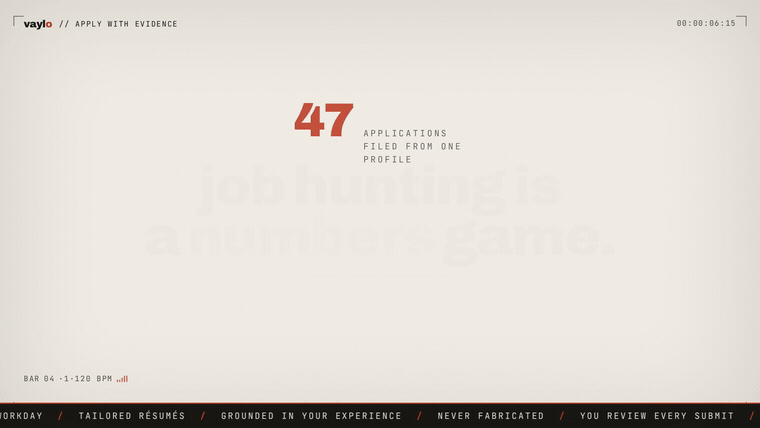

# JobFlow

Job-application tooling: keep one career profile, tailor a resume and cover letter
to each role with an LLM, draft application answers for your review, autofill real
application forms through a companion Chrome extension, and track every submission.
You confirm before anything is submitted.

## Demo

[](https://github.com/shashank123r/Vaylo-/raw/main/docs/media/vaylo-promo.mp4)

▶ [Watch the full 58-second promo in HD](https://github.com/shashank123r/Vaylo-/raw/main/docs/media/vaylo-promo.mp4)

> 📖 **New here? Read [`docs/OVERVIEW.md`](docs/OVERVIEW.md)** — an illustrated,
> screen-by-screen tour of what the app does (no code required).

## Build status

Verified working in this build (commands were run, not assumed):

- Installs cleanly (Next.js 16, React 19, Prisma 6, TypeScript strict). `tsc --noEmit` and `eslint` both pass.
- Postgres via `docker compose up -d db`; migrations create the full schema.
- `next build` compiles all 14 routes; the server was started and smoke-tested over HTTP.
- **Public-first browsing (no account):** landing, `/demo` how-it-works, `/jobs` list with search + source/remote filters, `/jobs/[id]` detail. Sample listings are clearly labeled demo data.
- **Progressive signup:** a protected action (Save / Apply) on a public job sends a guest to login with the **exact** destination preserved (job + intent), then returns them to that workflow. Verified end to end at runtime: guest → signup → job imported & persisted → landed in the workspace.
- **Auth:** email/password signup + login, bcrypt hashing, hashed server-side session tokens in httpOnly cookies, logout. Edge middleware guards `/app/*`; the layout re-validates server-side.
- **Tenant isolation:** every user-owned query filters by `userId`; verified in tests and over HTTP (one user cannot open another's job workspace or generate against it).
- **Profile editor + onboarding**, **job save**, **Claude-powered tailoring** (resume + cover letter via the provider abstraction; mock labels its output), **application tracker**, and **explicit-confirmation submission** (never auto-submits).
- **Resume library:** PDF/DOCX upload with magic-byte + size validation, text extraction (unpdf/mammoth), private storage (random keys, mode 0600, outside the web root), owner-only download (IDOR-safe), and delete. Wired into `/app/profile`; runtime-verified.
- **Manual job entry:** `/app/jobs/new` adds any job by title/company/URL/description (source "manual"), with an SSRF-safe URL validator for future server-side fetches.
- **Chrome MV3 extension** (`extension/`, build with `npm run ext:build` → load `extension/dist` unpacked): secure pairing (short-lived revocable token), Greenhouse/Lever/Ashby adapters, content-script autofill that fills only approved fields and **never** sensitive questions or the submit button, user-reported outcome. See `extension/README.md`. Backend flow runtime-verified; live-ATS autofill not validated from this environment.
- **Free-quota enforcement:** 3 lifetime confirmed successful submissions per account, then a subscription is required. Atomic (Serializable tx), idempotent per attempt, failed/uncertain never count. `/app/settings/extension` shows the allowance and pairing.
- **37 automated tests pass** (`npm test`, 9 files): everything above plus extension pairing/quota/isolation, ATS adapter detection + safe mapping (jsdom fixtures), and content-script autofill.
- `npm run db:seed` creates a labeled demo account (`demo@jobflow.local` / `demo-password`).

Not yet built (intentionally NOT faked; see JOBFLOW_STATUS.md for the precise next task):

- Live-ATS adapter validation, multi-step forms, optional guarded auto-submit (needs a real browser + permitted pages).
- Stripe billing UI (dev entitlement works; real payments need keys).
- Job-fit scoring UI, answer-drafting UI, data export/deletion, admin/support surface.

## What needs YOUR input or credentials (cannot be faked)

- **Anthropic API key** — set `ANTHROPIC_API_KEY` and `LLM_PROVIDER=anthropic` to use the real model. Without it the app runs on the `mock` provider (clearly labeled, no fabricated content).
- **Claude Bridge protocol** — no bridge protocol was documented in this repository. `src/lib/llm/bridge.ts` implements ONE explicit, clearly-labeled contract and will fail loudly if your bridge differs. It does not invent a vendor API. Confirm your bridge's real protocol before enabling `LLM_PROVIDER=bridge`.
- **Payment provider** — billing defaults to a labeled `dev` adapter that never charges. Real billing needs Stripe credentials.
- **Live ATS pages** — extension autofill adapters must be validated against real Greenhouse/Lever/Ashby application pages, which cannot be done from this build environment.

## Stack

Next.js (App Router) · React · TypeScript (strict) · Prisma · PostgreSQL ·
Tailwind · Zod · Pino · Anthropic SDK.

## Local setup

```bash
cp .env.example .env         # then edit values
docker compose up -d db      # start Postgres
npm install
npx prisma migrate dev       # create schema
npm run db:seed              # seed reference/demo data
npm run dev                  # http://localhost:3000
```

## Design system

Warm off-white `#F7F5F0`, white surfaces, charcoal `#252824`, muted brick red
`#B84A3A`, subtle stone borders. No purple, neon, gradients, or glassmorphism.
Defined in `tailwind.config.ts` and `src/app/globals.css`.

## Security posture (intended, enforced incrementally)

- All secrets server-side; validated at boot in `src/lib/env.ts`.
- Every user-owned row carries `userId`; queries always filter by it (tenant isolation).
- Session tokens stored hashed; baseline security headers in `next.config.mjs`.
- Uploads go to private storage, never a public URL.
- Guards planned against IDOR, XSS, CSRF, SSRF, prompt injection, and unsafe uploads.

## Deployment

See **`docs/DEPLOY.md`** for the full production deployment guide (env vars, database
migration, build/run, platform notes, and a pre-flight + smoke-test checklist).
Extension publishing is in **`docs/PUBLISH_EXTENSION.md`**.
