# Vaylo / JobFlow — Complete Feature Guide

**An exhaustive, screen-by-screen reference to every feature, page, control, field, button, and state in the application.**

This document is the single source of truth for what the product does. It covers every screen with a screenshot, and describes every interactive element down to individual buttons and form fields, including empty, filled, loading, and error states.

- **Product name:** Vaylo (also referred to internally as JobFlow)
- **What it is:** a job-application assistant. It keeps your career information in one place, tailors a resume and cover letter to each role using AI, lets you download each tailored resume as a clean PDF, analyses job fit, tracks every application, and — on a paid plan, with your explicit authorization — can auto-fill and auto-submit supported employer forms.
- **Live URL (current):** `http://13.238.23.72` (the custom domain `vaylo.co.in` is provisioned; HTTPS goes live once the DNS A record points at the server).
- **AI engine:** Claude (Anthropic) via **Amazon Bedrock** — model **Claude Haiku 4.5**.

---

## Table of contents

1. [Core principles (guardrails)](#1-core-principles-guardrails)
2. [The landing page](#2-the-landing-page)
3. [Pricing](#3-pricing)
4. [Browsing without an account (demo)](#4-browsing-without-an-account-demo)
5. [Browse jobs (live listings)](#5-browse-jobs-live-listings)
6. [Creating an account (sign up)](#6-creating-an-account-sign-up)
7. [Signing in](#7-signing-in)
8. [The app shell — header & navigation](#8-the-app-shell--header--navigation)
9. [Dashboard](#9-dashboard)
10. [Application profile](#10-application-profile)
11. [Resume upload, autofill & documents](#11-resume-upload-autofill--documents)
12. [Add a job manually](#12-add-a-job-manually)
13. [The job workspace](#13-the-job-workspace)
14. [Tailored resume & PDF download](#14-tailored-resume--pdf-download)
15. [Cover letter](#15-cover-letter)
16. [Job-fit analysis](#16-job-fit-analysis)
17. [Recording a submission](#17-recording-a-submission)
18. [Auto-apply](#18-auto-apply)
19. [Application tracker](#19-application-tracker)
20. [Billing & plans](#20-billing--plans)
21. [Browser extension & its settings](#21-browser-extension--its-settings)
22. [The AI engine](#22-the-ai-engine)
23. [Security & privacy](#23-security--privacy)
24. [Responsive / mobile layout](#24-responsive--mobile-layout)
25. [Technical architecture](#25-technical-architecture)
26. [Feature status summary](#26-feature-status-summary)

---

## 1. Core principles (guardrails)

These rules are enforced in code across the whole product and explain *why* features behave the way they do:

- **Never invents facts.** The AI uses only information you entered or that was extracted from your uploaded resume. Grades, dates, employers, skills, metrics, work authorization, and years of experience are never fabricated. Unknown stays blank.
- **You authorize every submission.** Nothing is submitted to an employer without (a) the instance master switch being on, (b) an active paid plan, and (c) your explicit per-run authorization. The default everywhere is "prepare" — fill, never submit.
- **Success is evidence-based.** A submission is only counted as successful when a confirmation is actually observed; never because a button was clicked.
- **Pauses, never bypasses.** On a sign-in wall, MFA, CAPTCHA/anti-bot, or a required sensitive question, the automation stops and asks you. It never bypasses access controls.
- **Your data is private.** Every record is scoped to your account. Resumes and tailored PDFs are owner-only — nobody else can fetch them.
- **Honest data.** Demo listings are clearly labelled. No fabricated jobs, metrics, or submissions.

---

## 2. The landing page

**URL:** `/` (public — no account needed)

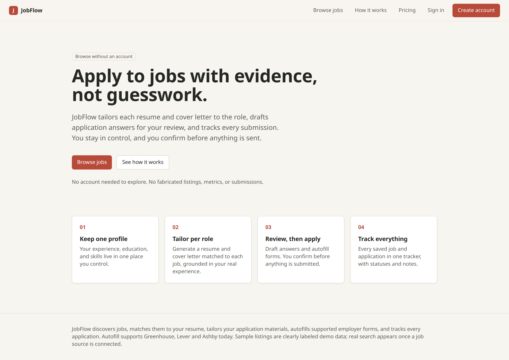

The landing page is the public entry point.

**Top navigation bar (left → right):**
- **JobFlow logo** (the "J" tile + wordmark) — links to the home page.
- **Browse jobs** — goes to the live job board (`/jobs`).
- **How it works** — anchors to the explainer section further down the page.
- **Pricing** — goes to `/pricing`.
- **Sign in** — goes to `/login`.
- **Create account** (brick-coloured button) — goes to `/signup`.

**Hero section:**
- A small pill badge: **"Browse without an account"** — signals you can explore before registering.
- Headline: **"Apply to jobs with evidence, not guesswork."**
- Sub-text explaining that JobFlow tailors each resume and cover letter, drafts answers for review, and tracks every submission, and that *you stay in control and confirm before anything is sent*.
- Two call-to-action buttons:
  - **Browse jobs** (brick, primary) → `/jobs`
  - **See how it works** (outlined, secondary) → anchors to the steps.
- A reassurance line: *"No account needed to explore. No fabricated listings, metrics, or submissions."*

**"How it works" — four numbered steps (cards 01–04):**
1. **Keep one profile** — your experience, education, and skills live in one place you control.
2. **Tailor per role** — generate a resume and cover letter matched to each job, grounded in your real experience.
3. **Review, then apply** — draft answers and autofill forms; you confirm before anything is submitted.
4. **Track everything** — every saved job and application in one tracker with statuses and notes.

**Footer text** summarises what the product does and which form systems are supported (Greenhouse, Lever, Ashby) and that real listings appear once a job source is connected.

---

## 3. Pricing

**URL:** `/pricing` (public)

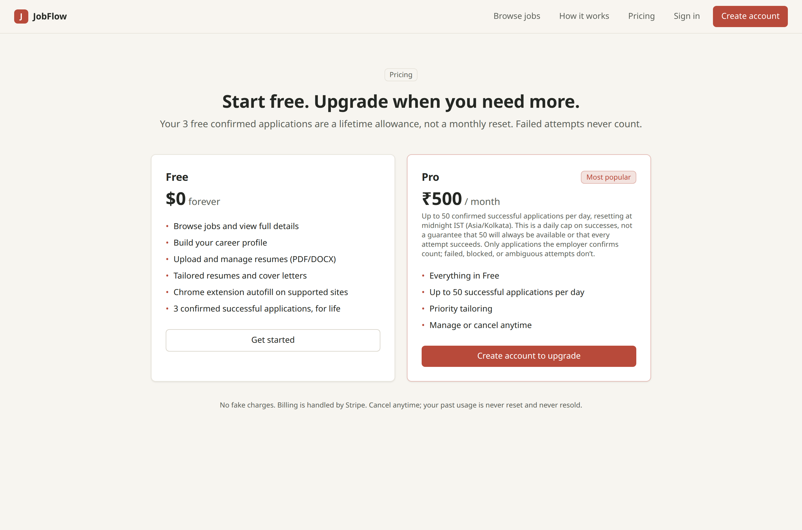

Presents the two plans:

- **Free** — **3 confirmed successful submissions for life** (counted per email, so deleting and recreating an account does not reset it). Includes profile, tailoring, PDF download, and tracking.
- **Pro — ₹500 / month** — **up to 50 confirmed successful submissions per day**, resetting at **midnight IST (Asia/Kolkata)**. The 50/day is a cap on *successes*: only applications with reliable employer confirmation count; failed, blocked, or ambiguous attempts don't consume quota, and capacity is reserved before each attempt so concurrent runs can't overshoot.

> **Status note:** payments are not yet live — the current billing adapter never charges. Pricing/quota logic is implemented and enforced server-side; collecting the ₹500 requires connecting a real payment provider.

---

## 4. Browsing without an account (demo)

**URL:** `/demo` and `/jobs/demo`

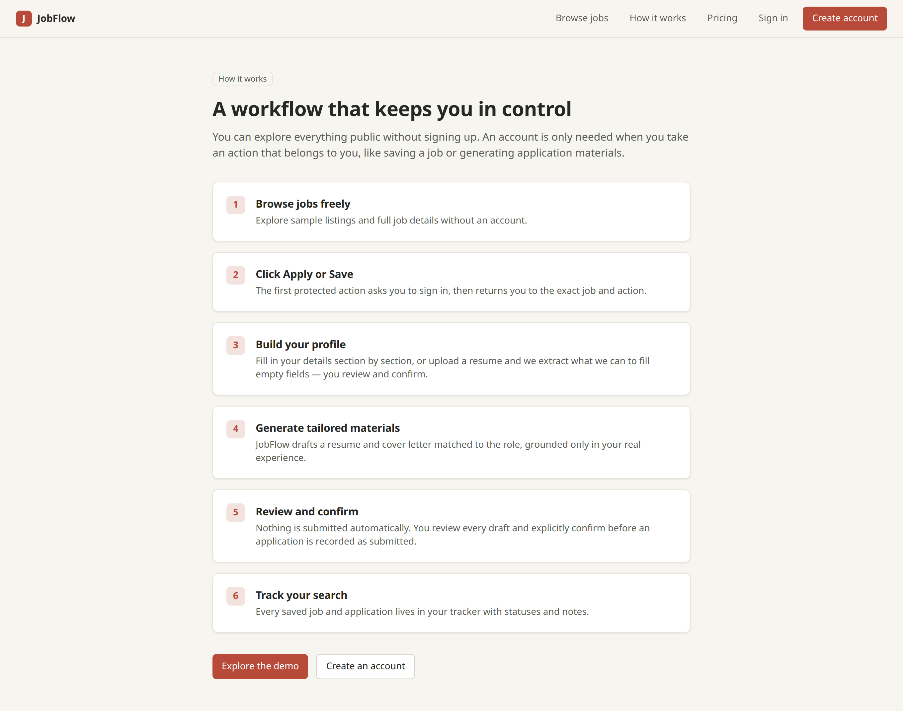

The demo lets a visitor see the full workflow with **clearly-labelled sample data** — no account required, nothing fabricated as if it were real.

**Demo listings** (`/jobs/demo`):

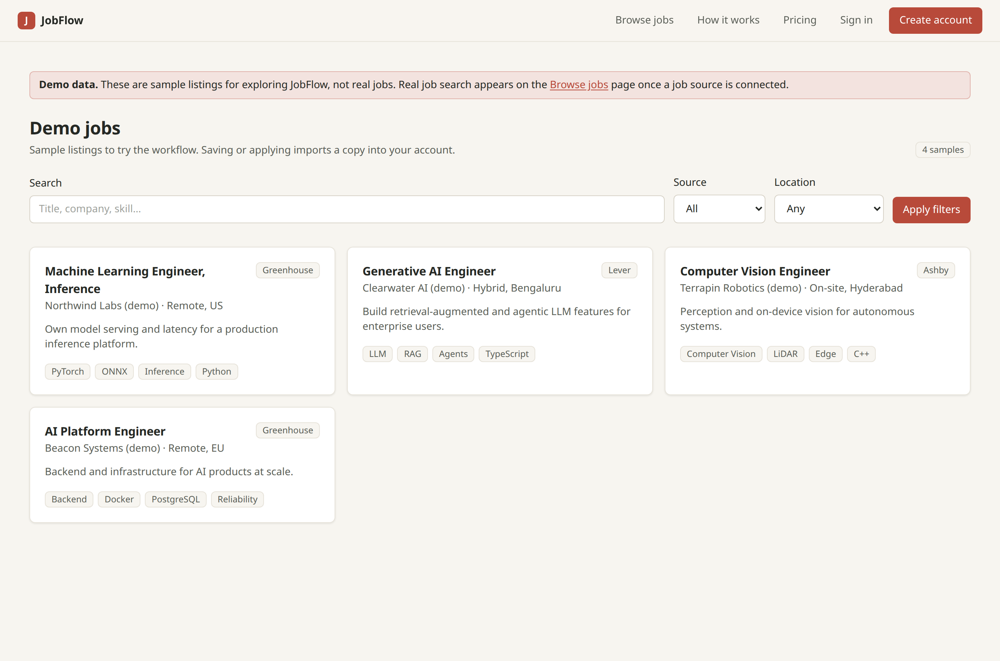

A labelled set of sample jobs. Each demo job opens a detail view:

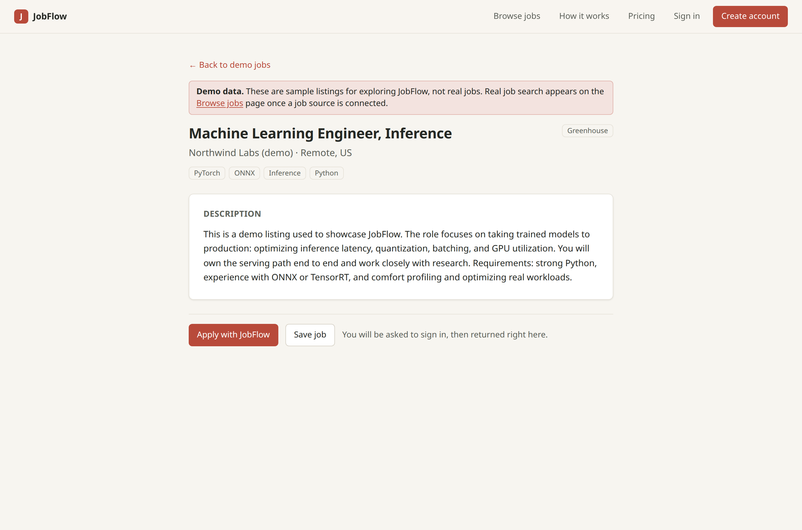

From a demo job you can click **Apply with JobFlow** or **Save** — these start a guided flow that asks you to sign up, then imports that demo job into your account so you can see tailoring and tracking end to end.

---

## 5. Browse jobs (live listings)

**URL:** `/jobs` (public; richer when signed in)

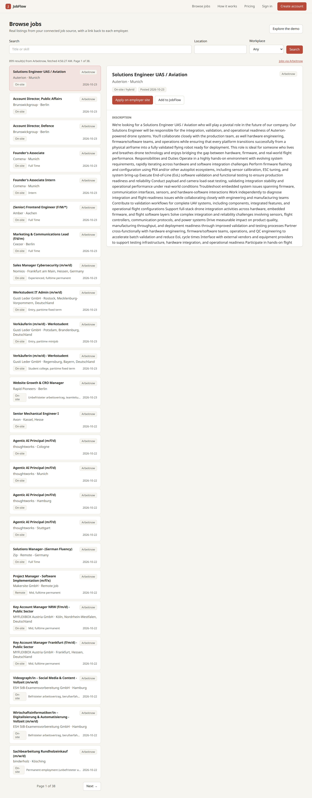

This is the real job board, backed by a live provider.

**Header row:** title **"Browse jobs"**, a short description, and an **"Explore the demo"** button (top-right) that jumps to the labelled sample data.

**Search bar (three controls + button):**
- **Search** — a free-text box for *title or skill*.
- **Location** — a free-text location box.
- **Workplace** — a dropdown: **Any**, remote, or on-site/hybrid.
- **Search** button (brick) — runs the query.

**Results summary line:** e.g. *"900 result(s) from Arbeitnow, fetched 11:48:23 AM. Page 1 of 38."* — this shows the real source (**Arbeitnow**, a free public job feed), the fetch time, and pagination. A **"Jobs via Arbeitnow"** attribution link appears on the right.

**Two-pane layout:**
- **Left — the job list.** Each card shows the job **title**, **company**, **location**, small **badges** (e.g. "On-site / hybrid", contract type), the **posted date**, and a source badge ("Arbeitnow"). Clicking a card selects it.
- **Right — the detail panel** for the selected job: title, company, badges (workplace/hybrid, contract type, "Posted <date>"), the full **description**, and the action buttons:
  - **Apply on employer site** (brick) — opens the employer's own posting in a new tab.
  - **Add to JobFlow** — adds the job to your account so you can tailor materials and track it.

> **Status note:** the connected provider (Arbeitnow) is a free EU/German feed, so most live listings are European. Swapping to a different source (e.g. an India-focused feed) is a configuration change.

---

## 6. Creating an account (sign up)

**URL:** `/signup`

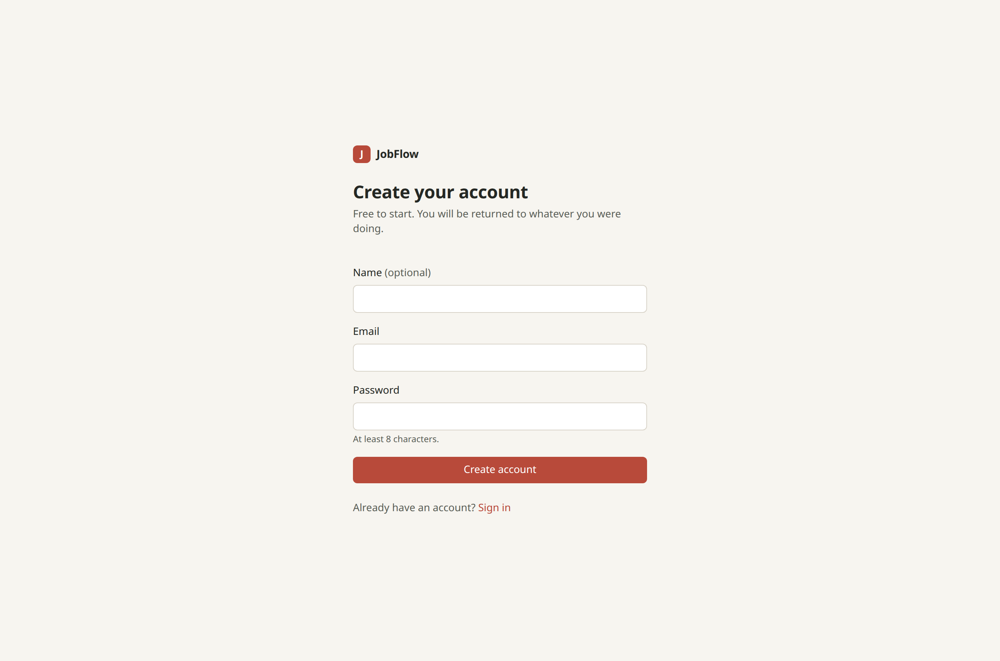

A centered, focused form (the page intentionally uses a narrow centered layout rather than full-width, because it is a single focused task).

**Fields & controls:**
- **Name** — optional. If provided, it's used to greet you and as a default on your profile.
- **Email** — required, must be a valid email. Stored lowercased, so case never creates a duplicate account.
- **Password** — required, **minimum 8 characters**.
- **Create account** button (brick) — submits.
- A **"Sign in"** link for people who already have an account.

**Behaviour & states:**
- **Validation errors** (invalid email, password too short, empty fields) appear in a red banner above the form with a specific message (e.g. *"Use at least 8 characters."*).
- **Duplicate email** — if an account already exists, you get *"An account with that email already exists. Sign in instead."* with the Sign in link right there.
- **Rate limiting** — sign-up attempts are capped per client (8 per hour) to deter mass/bot signups; exceeding it shows *"Too many sign-up attempts. Try again in about N minutes."*
- On success you're signed in immediately and taken to your dashboard. The session cookie is `HttpOnly`, `SameSite=Lax`, and marked `Secure` only when served over HTTPS (so login works over plain HTTP during setup, and is fully protected over HTTPS).

---

## 7. Signing in

**URL:** `/login`

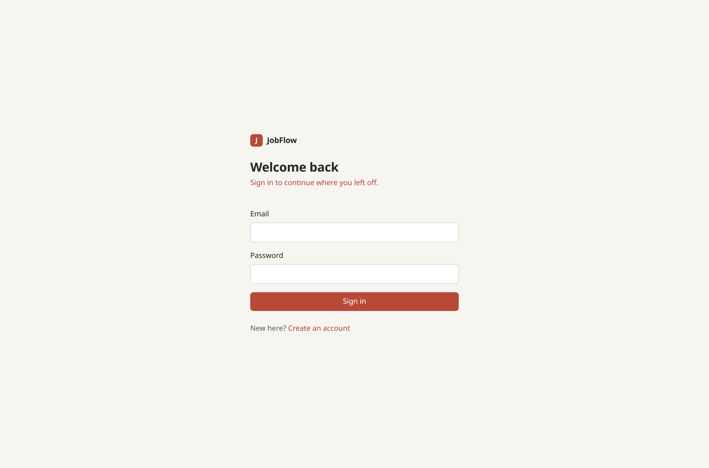

A centered form matching the sign-up page.

**Fields & controls:**
- **Email** — required, valid email (case-insensitive — `Foo@Bar.com` and `foo@bar.com` are the same account).
- **Password** — required.
- **Sign in** button (brick).
- A **"Create an account"** link.

**Behaviour & states:**
- A contextual **note** appears at the top when you were redirected here mid-action (e.g. *"Sign in to continue your application."* or *"Sign in to save this job to your account."*).
- **Wrong credentials** show a single generic message — *"Invalid email or password."* — for both "no such user" and "wrong password", so the form never reveals whether an email is registered (no user enumeration).
- **Rate limiting** — repeated failed logins are throttled (10 failures per 10 minutes per client); a successful login resets the counter.
- On success you land back wherever you were headed (or the dashboard).

---

## 8. The app shell — header & navigation

Once signed in, every page shares a common header.

**Header (left → right):**
- **JobFlow logo** — returns to the dashboard.
- **Primary nav links:** **Dashboard**, **Tracker**, **Auto-apply**, **Browse jobs**, **Profile**, **Extension**, **Billing**.
- **Your email** (right side) — shows which account you're in.
- **Sign out** button — ends your session (a POST, so it can't be triggered by a stray link), clears the session cookie, and returns you to the home page.

On small screens the primary links collapse into a **mobile menu**.

The content area is wide (up to 1800px) and each page chooses the right layout for its content: full-width for dashboards/lists/workspaces, and a centered max-width column for focused forms and reading.

---

## 9. Dashboard

**URL:** `/app`

**Empty state (brand-new account):**


**Active state (profile set up, jobs saved):**

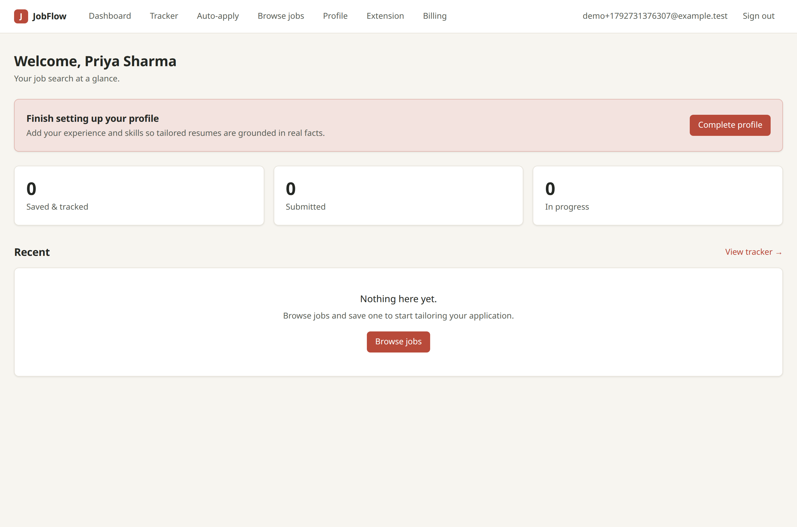

The dashboard is your "at a glance" home.

**Elements:**
- **"Welcome, {name}"** heading + a one-line subtitle.
- **"Finish setting up your profile"** banner (shown until your profile is ready) with a **Complete profile** button → the profile wizard. It disappears once your essentials are in place.
- **Three stat cards:**
  - **Saved & tracked** — jobs you've added.
  - **Submitted** — applications marked submitted.
  - **In progress** — saved/started but not yet submitted.
- **Recent** section — a short list of your latest jobs/activity with a **"View tracker →"** link. When empty it shows *"Nothing here yet. Browse jobs and save one to start tailoring your application."* with a **Browse jobs** button.

---

## 10. Application profile

**URL:** `/app/profile`

The profile is built section-by-section with **save-as-you-go**. It is the factual basis for all AI tailoring — the AI is only allowed to use what's here (plus what's extracted from your resume).

**Overview (top of every profile view):**

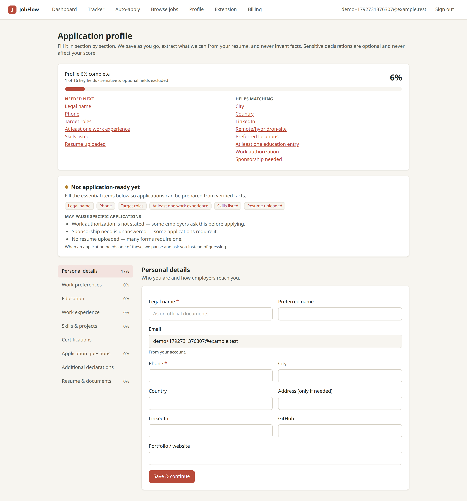

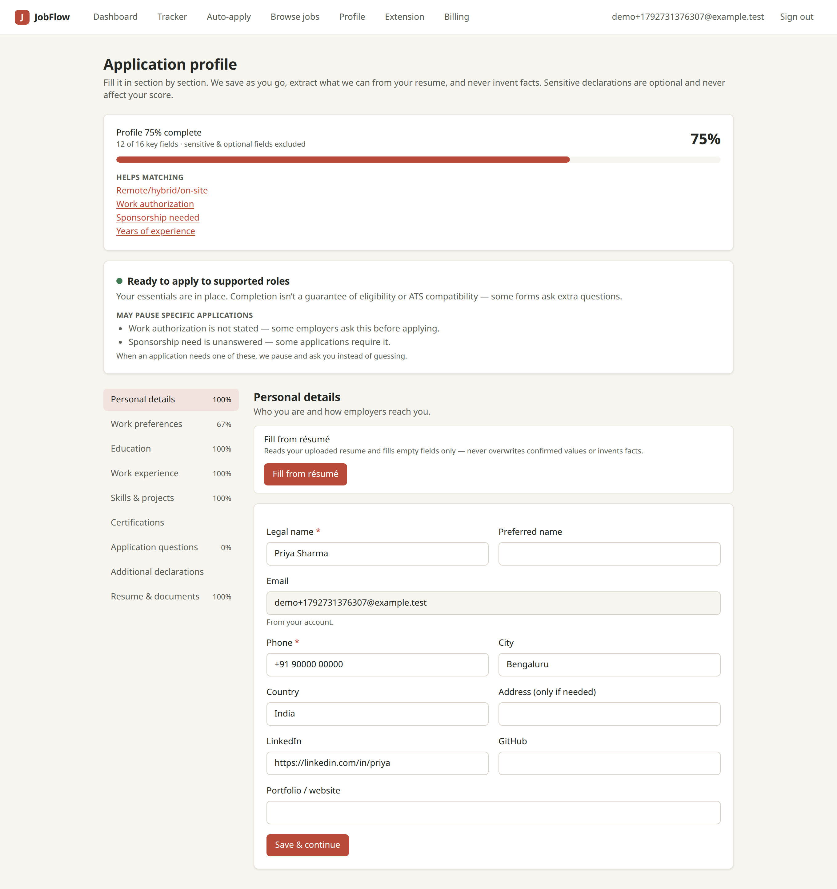

- **Completion meter** — e.g. *"Profile 38% complete — 6 of 16 key fields"* with a progress bar and the big percentage. Sensitive and optional fields are **excluded** from the score.
- **"Needed next"** list — the essential items still missing (Legal name, Phone, Target roles, at least one work experience, Skills listed, Resume uploaded). Each is a link that jumps to the right section.
- **"Helps matching"** list — optional-but-useful items (City, Country, LinkedIn, Remote/on-site preference, Preferred locations, at least one education entry, Work authorization, Sponsorship needed).
- **Readiness panel** — a status dot + heading (**"Ready to apply to supported roles"** or **"Not application-ready yet"**), the blocking items as badges, and a **"May pause specific applications"** list (e.g. work authorization unanswered, sponsorship unanswered, no resume) — these are things that would make an automated application pause and ask you rather than guess.

**Section navigation (left column)** — each section shows its own completion %:
Personal details · Work preferences · Education · Work experience · Skills & projects · Certifications · Sensitive declarations · Documents.

**"Fill from résumé" button** — appears once you've uploaded a resume. It re-runs AI extraction against your latest resume and **fills only empty fields** (name, phone, city, country, LinkedIn, plus education/experience/skills), never overwriting values you've confirmed and never inventing anything. It shows a banner reporting how many fields were filled.

### 10.1 Personal details

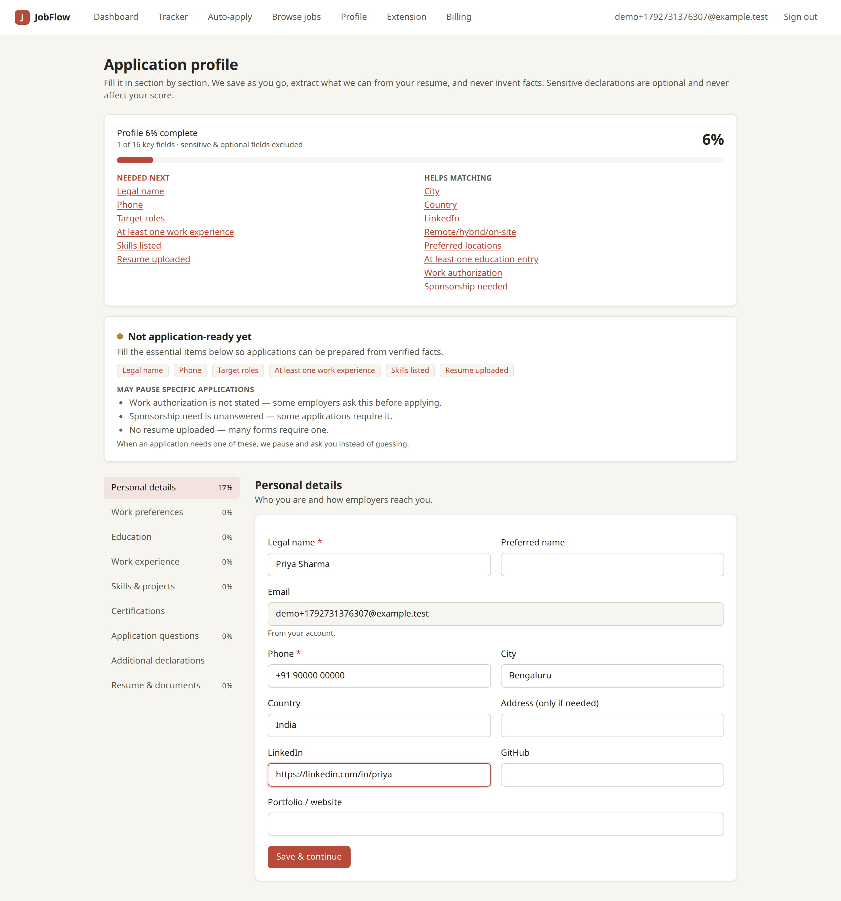

Fields (required fields marked **\***):
- **Legal name \*** (required) — as on official documents.
- **Preferred name** — optional.
- **Email** — read-only, shown from your account.
- **Phone \*** (required).
- **City**, **Country**, **Address** (address only if needed).
- **LinkedIn**, **GitHub**, **Portfolio / website**.
- **Save & continue** button saves this section.

Required fields show a red asterisk and are enforced in the browser (and the save is validated server-side).

### 10.2 Work preferences

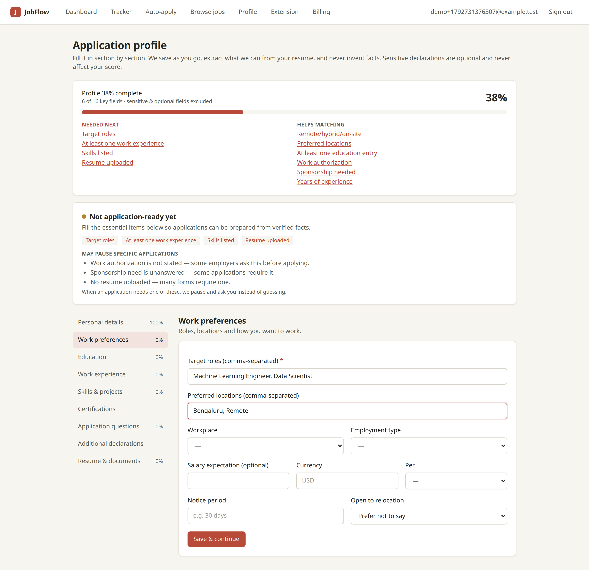

- **Target roles \*** (required, comma-separated) — e.g. "Machine Learning Engineer, Data Scientist". Drives job matching.
- **Preferred locations** (comma-separated).
- **Workplace type** / **Employment type** selectors.
- **Minimum salary** + **currency** + **period**.
- **Notice period**.
- **Open to relocation** (yes / no / unspecified).
- **Save & continue**.

### 10.3 Education

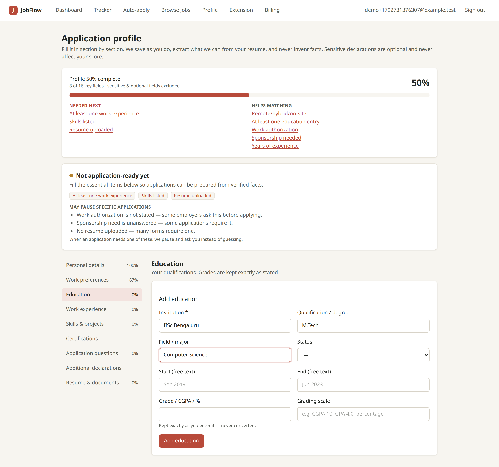

Add multiple entries. Per entry: **School**, **Degree**, **Field**, **Start/End dates**, **Grade** + **Grade scale** (kept **exactly as entered, never converted**), **Graduation status**. Each saved entry appears in a list with a **Delete** control. "School" is required to add an entry.

### 10.4 Work experience

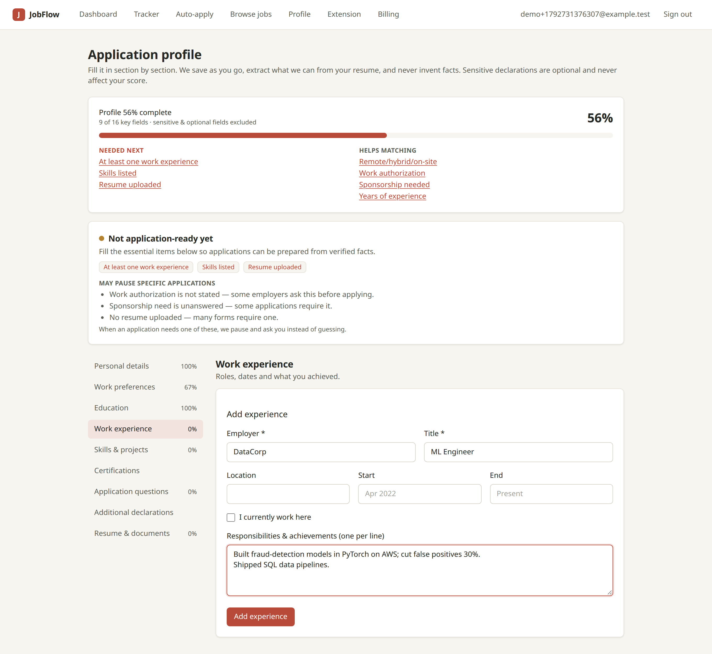

Add multiple roles. Per role: **Company \***, **Title \***, **Location**, **Start/End dates**, **"Current"** checkbox, and **Highlights** (one achievement per line). Saved roles list with **Delete**. Company and title are required.

### 10.5 Skills & projects

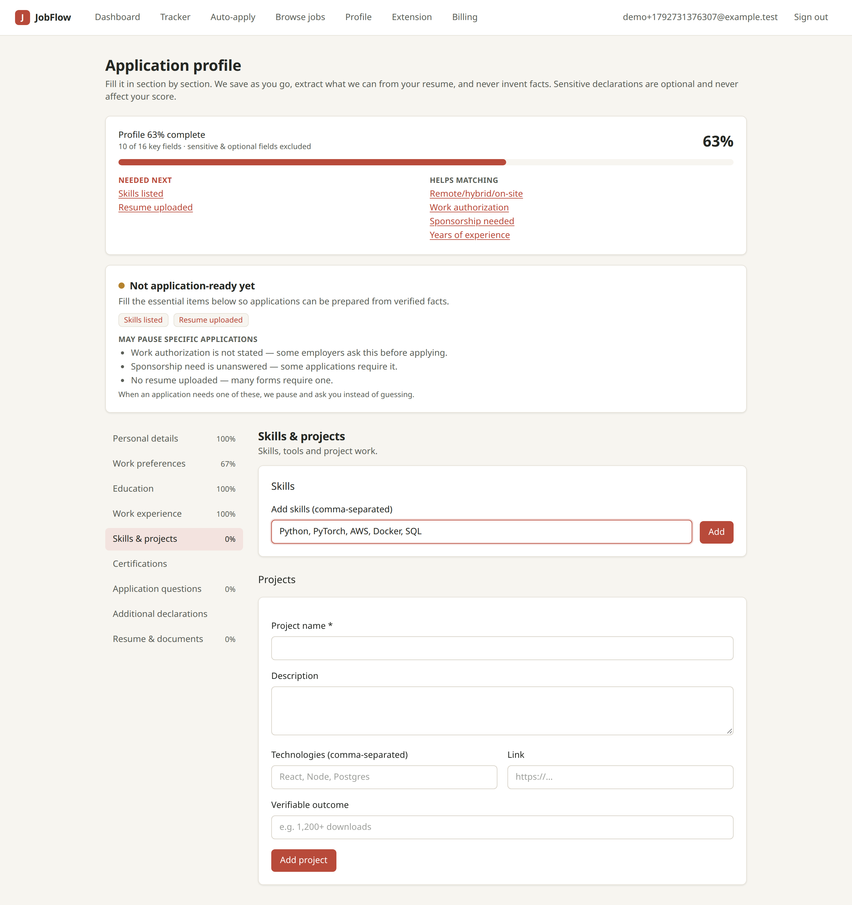

- **Skills** — add several at once as a comma-separated list, with an optional **category**. Each skill chips in a list with **Delete**.
- **Projects** — **Name \***, **Description**, **Technologies** (comma-separated), **URL**, **Outcome**. Listed with **Delete**.

### 10.6 Certifications

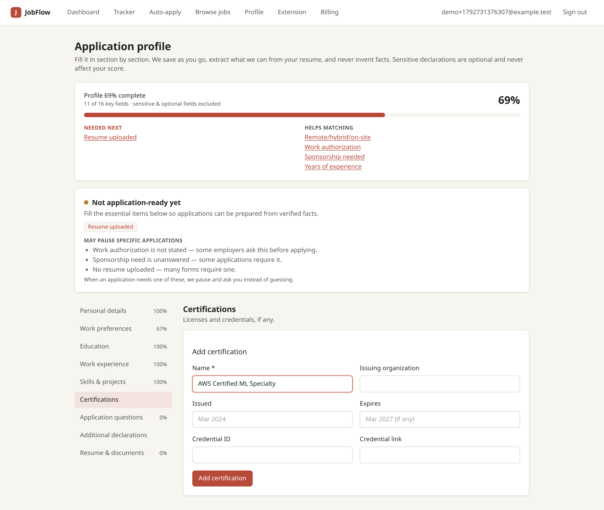

Per certification: **Name \***, **Issuer**, **Issue date**, **Expiry date**, **Credential ID**, **URL**. Listed with **Delete**.

### 10.7 Sensitive declarations

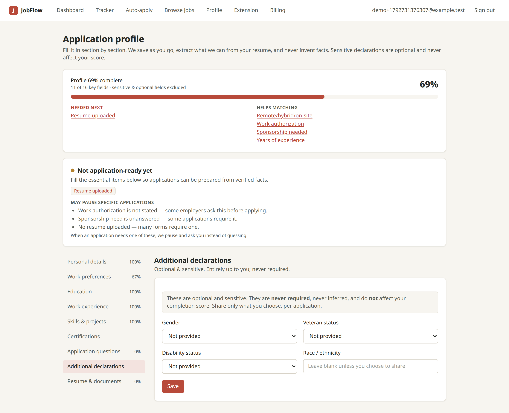

Optional self-identification fields: **Gender**, **Ethnicity**, **Disability status**, **Veteran status**. These are **never required, never inferred, and excluded from your completion score**. They exist only so that, if an application explicitly asks and you chose to provide them, the answer comes from you — never a guess.

---

## 11. Resume upload, autofill & documents

**URL:** `/app/profile?s=documents`

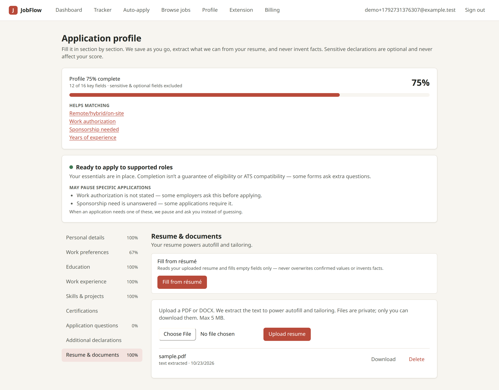

**Upload:**
- A **file picker** accepting **PDF or DOCX** (`accept` is enforced; non-PDF/DOCX files are rejected with *"Only PDF and DOCX resumes are accepted."*).
- On upload the file is stored privately and its text is extracted. The extracted text is then used for **resume autofill**: the AI pulls structured facts (name, phone, location, skills, experience, education) and **fills only empty profile fields**, marking them **"from resume"** for your review. It never overwrites a value you've confirmed; if a confirmed value conflicts with the resume, it's **flagged for review, not changed**.

**Per uploaded resume:**
- **Download** — fetches your original file (owner-only; a 404 for anyone else).
- **Delete** — removes it.

**"Fill from résumé"** (also surfaced on the Personal section):


A button that re-runs the autofill on demand against your latest uploaded resume.

> **Extraction quality** depends on the AI model and the resume. With the live Bedrock model it reads real resume text; the apply/provenance/conflict logic is fully tested and never fabricates.

---

## 12. Add a job manually

**URL:** `/app/jobs/new`

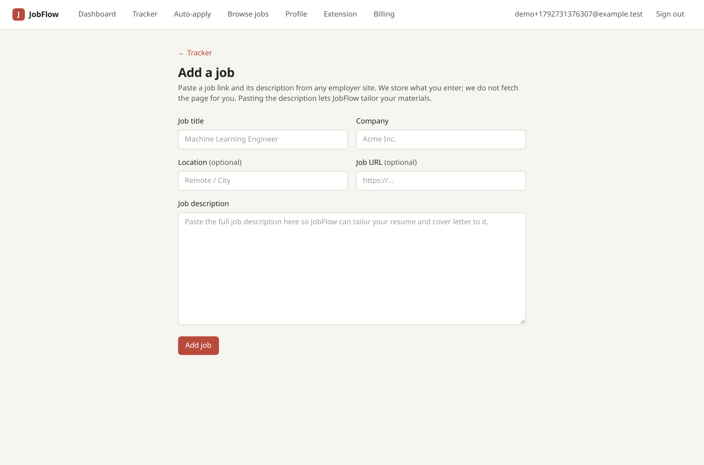

A centered form to add any job (e.g. one you found elsewhere):
- **Title \*** (required)
- **Company \*** (required)
- **Location**
- **URL** (the posting link)
- **Description** (paste the job description — the more detail, the better the tailoring)
- **Add job** button — creates the job, saves it to your tracker, and opens its workspace.

---

## 13. The job workspace

**URL:** `/app/jobs/{id}`

This is where you prepare and track an individual application. It's a full-width workspace.

**Empty state (just added):**

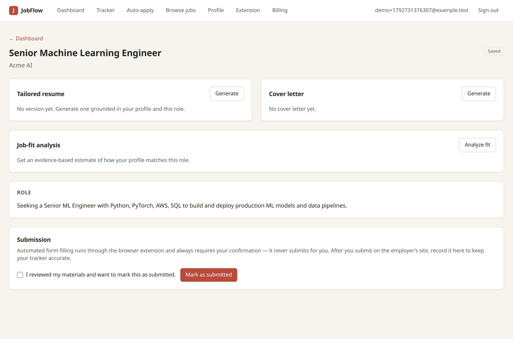

**Full state (materials generated):**

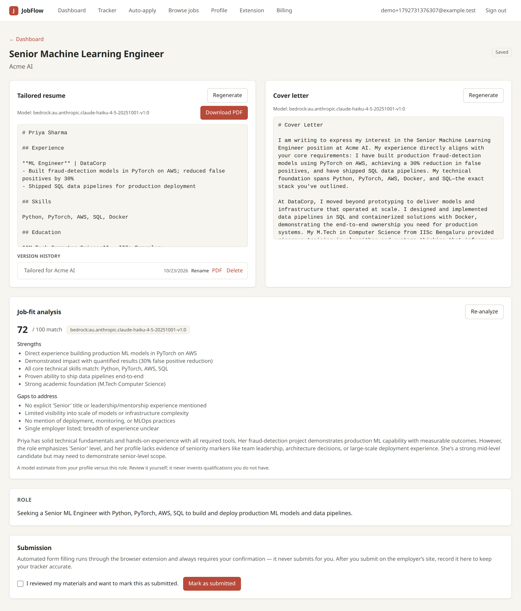

**Top of page:**
- **"← Dashboard"** back link.
- The job **title** and **company**.
- A **status badge** (saved / submitted).
- An **error banner** area (used if a generation fails — see below).
- If you arrived via "Apply with JobFlow", a prompt to generate your materials and confirm when ready.

The workspace has four areas, described in the next four sections: **Tailored resume**, **Cover letter**, **Job-fit analysis**, and **Submission**.

---

## 14. Tailored resume & PDF download

The **Tailored resume** card (top-left of the workspace).

**Controls & elements:**
- **Generate** button — the first time; becomes **Regenerate** once a version exists. Each generation produces a **new version** and **never overwrites** earlier ones.
- **Model** line — shows which AI produced it (e.g. `bedrock:au.anthropic.claude-haiku-4-5-...`) for provenance.
- **Content preview** — the tailored resume in a scrollable panel.
- **Download PDF** button (brick) — downloads a clean, ATS-friendly PDF of the latest version (see below).
- **Version history** — every earlier version for this job, each row showing:
  - an **editable name** field + **Rename** (defaults to "Tailored for {company}"),
  - the **creation date**,
  - a **PDF** link to download that specific version,
  - a **Delete** link (removes only that version — never the original resume or other versions).

**What the tailoring does (requirement-level detail):**
- Keeps every fact truthful and unchanged — employers, titles, dates, education, skills, certifications, and any metrics exactly as you entered them. It never adds a skill, tool, employer, responsibility, or metric you don't have.
- Where your **real** experience genuinely matches the role, it mirrors the job's own terminology/keywords so the resume passes **ATS keyword screening** — but only for things you actually have.
- Leads with the most relevant experience; writes concise, impact-first bullets.
- Uses standard ATS sections (Summary optional, Experience, Skills, Education, Projects/Certifications when present) with your name as the heading.
- If your profile is empty, it will **refuse** to invent a resume rather than fabricate one.

**The PDF (Download PDF):**
- A4, selectable text (not an image), standard serif fonts, clear section headings and bullets, sensible margins, and automatic pagination (long resumes flow to page 2 without clipping or blank pages). Special characters are preserved.
- **Owner-only:** the download route serves a version only to its owner; anyone else (or a signed-out request) gets a 404. File ids are therefore not an enumeration surface.
- Generated on demand from the stored Markdown using the server's headless browser — no third-party PDF service.

Example of the generated PDF:

```
Priya Sharma
EXPERIENCE
ML Engineer | DataCorp
 • Built fraud-detection models in PyTorch on AWS, reducing false positives by 30%
 • Developed and shipped SQL data pipelines for model training and inference
SKILLS
Python, PyTorch, AWS, Docker, SQL
```

---

## 15. Cover letter

The **Cover letter** card (top-right of the workspace).

- **Generate** / **Regenerate** button.
- **Model** provenance line.
- **Content** — three short, specific paragraphs grounded in your real experience. No clichés, no invented enthusiasm about facts you didn't provide. With an empty profile it refuses rather than fabricating.

---

## 16. Job-fit analysis

The **Job-fit analysis** card (full-width, below the resume/cover).


- **Analyze fit** / **Re-analyze** button.
- A **score out of 100** (e.g. "72 / 100 match") + the model provenance badge.
- **Strengths** — up to five bullets, strictly from your profile vs the role.
- **Gaps to address** — up to five bullets naming real gaps (it flags requirements you *don't* evidence, rather than pretending you meet them).
- A short **rationale** paragraph.
- A footnote: *"A model estimate from your profile versus this role. Review it yourself; it never invents qualifications you do not have."*

---

## 17. Recording a submission

The **Submission** card (bottom of the workspace).

- Explains that automated form filling runs through the browser extension and **always requires your confirmation** — it never submits for you.
- A **checkbox**: *"I reviewed my materials and want to mark this as submitted."*
- A **Mark as submitted** button — records the application as submitted in your tracker (only ever from this explicit confirmation).

---

## 18. Auto-apply

**URL:** `/app/auto-apply`

The page shows **one mode, chosen by your plan** (not both) and uses a full two-column layout.

**Free plan — in-browser mode:**

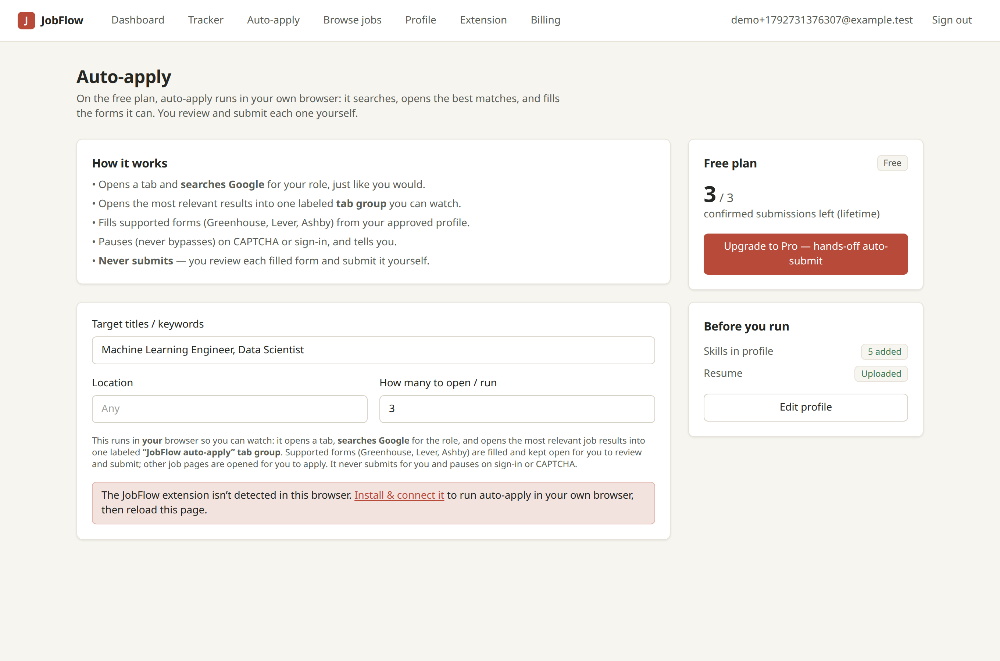

- **"How it works"** card: opens a tab, searches Google for your role, opens the most relevant results into one labelled tab group, fills supported forms (Greenhouse, Lever, Ashby) from your approved profile, pauses on CAPTCHA/sign-in, and **never submits** — you review and submit each one yourself.
- **"Run auto-apply in your browser"** form: **Target titles / keywords**, **Location**, **How many to open / run**, and a **Run in my browser** button. If the companion extension isn't detected, a banner explains how to install & connect it.
- **Right sidebar:**
  - A **plan card**: "Free plan", your remaining confirmed submissions (e.g. "3 / 3 — confirmed submissions left (lifetime)"), and an **"Upgrade to Pro — hands-off auto-submit"** button.
  - A **"Before you run"** card: readiness badges for **Skills in profile** and **Resume**, plus an **Edit profile** button.

**Pro plan — server-side auto-submit mode (replaces the above for subscribers):**
- A run form with **Target titles/keywords**, **Minimum match score**, **Max applications / run**, and an explicit **authorization checkbox** — *"I authorize JobFlow to submit applications on my behalf for this run."*
- The engine discovers jobs, matches each to your profile, fills supported forms, **uploads your resume**, and submits **only** when live-submit is enabled on the instance **and** you're subscribed **and** you authorized the run — otherwise it stops at "filled". It verifies by evidence and records confirmed / unconfirmed / failed honestly. It pauses (never bypasses) on sign-in, CAPTCHA, or any question it shouldn't answer for you.
- If you have an **empty profile**, it guides you to set it up first instead of returning a wall of zero-match results.

> **Status note:** the server-side engine and its browser run in the deployed container, but live submission is **OFF by default** and has **not** been validated against real employer ATS — it is tested against controlled fixture forms. The in-browser extension mode requires the companion extension to be installed and paired.

---

## 19. Application tracker

**URL:** `/app/applications`

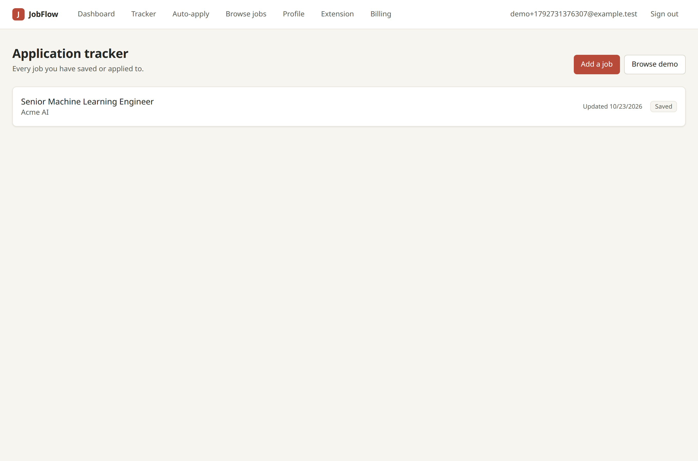

- Heading **"Application tracker"** with the subtitle *"Every job you have saved or applied to."*
- Buttons: **Add a job** (→ `/app/jobs/new`) and **Browse demo**.
- **Empty state:** a centered card — *"No applications yet. Save a job to start tracking it here."* + a **Browse jobs** button.
- **Populated state:** a full-width list where each row is a clickable link to that job's workspace, showing the **title**, **company · location**, the **date** (submitted or last updated), and a **status badge** (Saved / Submitted / In progress).

---

## 20. Billing & plans

**URL:** `/app/settings/billing`

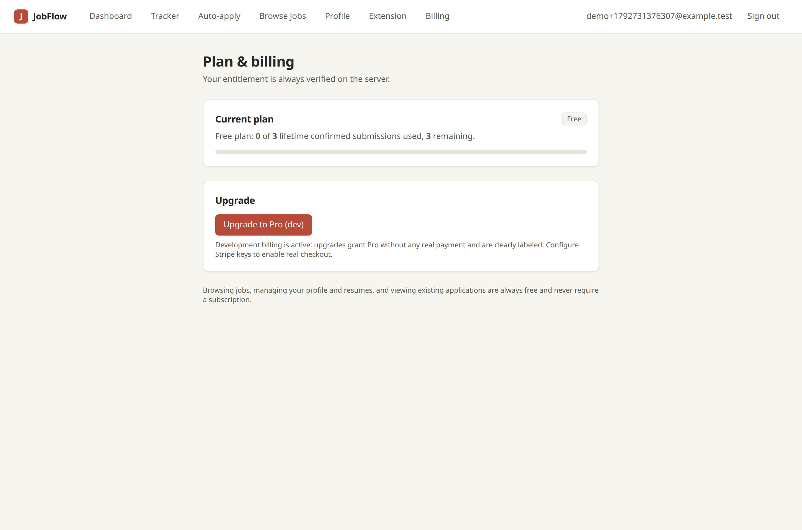

- Shows your **current plan** (Free or Pro) and **usage**:
  - **Free:** N of 3 lifetime confirmed submissions used.
  - **Pro:** N of 50 confirmed submissions used **today**, with the **reset time (midnight IST)**.
- An **Upgrade** path to Pro.

**How the quota actually works:**
- Only a **confirmed success** (reliable employer evidence) consumes quota. Failed, skipped, duplicate, blocked, or ambiguous attempts do not.
- Capacity is **reserved before each attempt** (two-phase: reserve → confirm / release / hold-if-uncertain), so concurrent runs across web + extension can never overshoot the cap.
- Pro resets daily at **midnight Asia/Kolkata**; Free is lifetime per email and survives account deletion/recreation.

> **Status note:** the current payment adapter **never charges** — it flips you to Pro instantly for testing. Collecting real money requires connecting a payment provider.

---

## 21. Browser extension & its settings

**URL:** `/app/settings/extension`

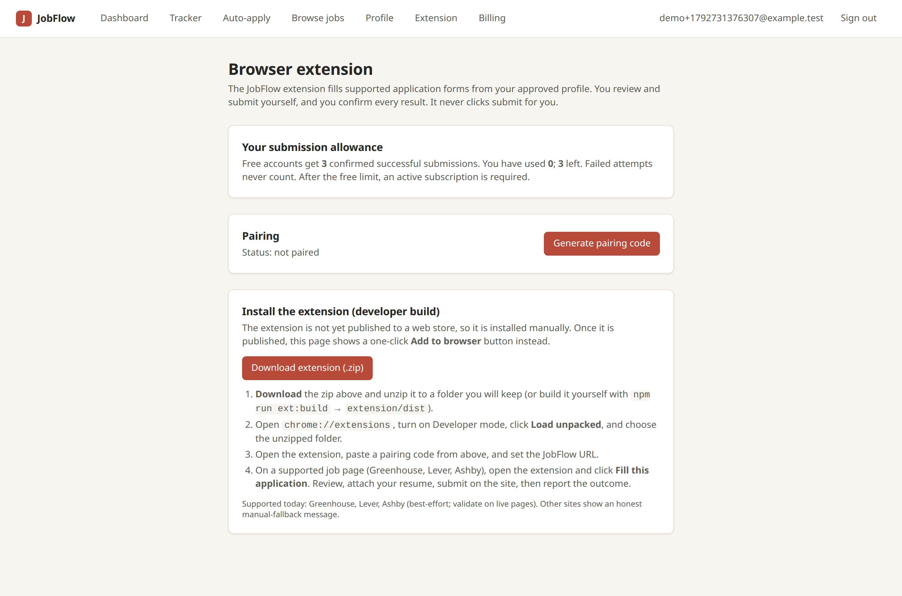

- Explains and links to the **companion Chrome extension**. When a public install link is configured, a one-click "Add to browser" button appears; otherwise it shows the developer "load unpacked" flow.
- The extension runs in **your** browser, opens tabs, searches, opens the top matches, and **fills** supported application forms from your approved profile. It **never submits** and **cannot upload a resume file** (browsers block scripted file inputs) — you attach the resume and submit yourself.
- It pairs with the site via an allowed-origin setting.

> **Status note:** the extension builds and its logic (field adapters, ranking, pairing, autofill) is unit-tested; it needs to be built, loaded into Chrome, and its allowed-origin pointed at the live host to be used end-to-end.

---

## 22. The AI engine

All AI features — resume tailoring, cover letters, job-fit analysis, and resume autofill — run on **Claude (Anthropic) via Amazon Bedrock**, model **Claude Haiku 4.5**.

- **No API key in the app** — the server uses the EC2 instance's IAM role to call Bedrock; credentials are never stored in the application.
- **Grounded & non-fabricating** — every prompt enforces the "never invent facts" rule. Each generation records which model produced it (the "Model:" provenance line).
- **Graceful failure** — if the AI is unavailable, features show *"Generation failed. The AI service was busy or unavailable. Please try again."* rather than crashing; the rest of the app is unaffected.
- **Cost** — billed per token to the AWS account (Haiku ≈ $1 / $5 per million input / output tokens).

---

## 23. Security & privacy

- **Sessions** — stored server-side as a hash; the cookie is `HttpOnly`, `SameSite=Lax`, and `Secure` on HTTPS.
- **Tenant isolation** — every query is scoped to the signed-in user. A job, resume version, or document belonging to someone else is simply unreachable (404 / redirect), so ids are not an IDOR surface.
- **Owner-only downloads** — both the original resume and each tailored-resume PDF are served only to their owner.
- **Rate limiting** — sign-up and login are throttled per client to deter abuse.
- **Security headers** — `Content-Security-Policy`, `X-Frame-Options: DENY`, `X-Content-Type-Options: nosniff`, `Referrer-Policy`, `Permissions-Policy`, and (over HTTPS) `Strict-Transport-Security`.
- **No secrets to third parties** — the app never sends your data to endpoints other than the configured job provider and the AI engine.

---

## 24. Responsive / mobile layout

Every page adapts from desktop to mobile. The two-column workspaces and sidebars stack; the primary nav collapses into a menu.

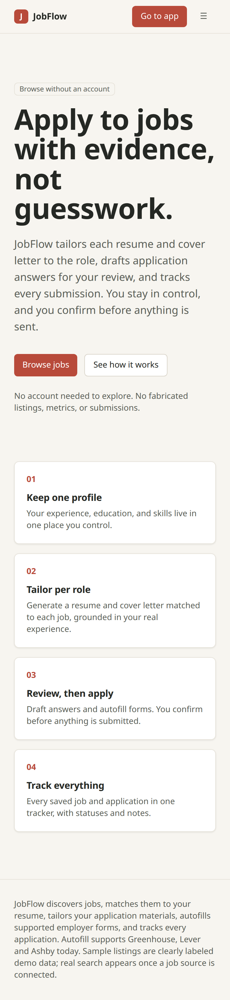

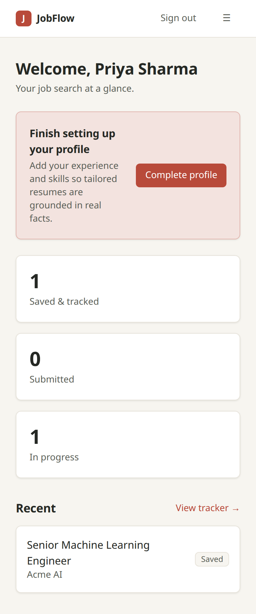

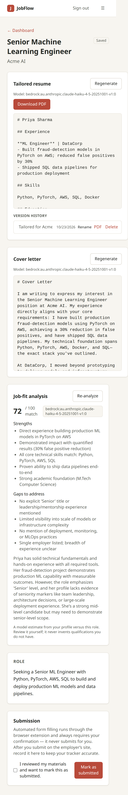

- Forms (sign up / sign in / add job / settings) use a centered, readable column.
- Dashboards, the tracker, the job workspace, and auto-apply use the full width on large screens and stack cleanly on small ones.
- There's no horizontal scrolling; controls and cards fit their containers.

---

## 25. Technical architecture

- **Framework:** Next.js (App Router), React, TypeScript (strict).
- **Database:** PostgreSQL via Prisma.
- **AI:** Amazon Bedrock (Claude Haiku 4.5) via the AWS SDK, using the instance IAM role.
- **PDF:** headless Chromium (Playwright) renders Markdown → HTML → PDF in-process (no extra service).
- **Jobs provider:** Arbeitnow (free, keyless) — pluggable.
- **Hosting:** a single AWS EC2 instance in `ap-southeast-2`, running the app, PostgreSQL, and a Caddy reverse proxy in Docker Compose. Caddy is pre-configured for `vaylo.co.in` with automatic HTTPS once DNS points at the server.
- **Auth:** custom email/password with hashed sessions.
- **Testing:** an automated suite (unit + real-browser engine/PDF tests) plus end-to-end checks.

---

## 26. Feature status summary

| Capability | Status |
|---|---|
| Accounts, sessions, tenant isolation | ✅ Live & tested |
| Section-wise profile + completion/readiness | ✅ Live & tested |
| Resume upload, parse, private storage, owner-only download | ✅ Live & tested |
| Resume → profile autofill (fill empty, mark provenance, flag conflicts, no invention) | ✅ Live (quality depends on the AI model) |
| **Resume tailoring (AI, grounded)** | ✅ Live via Bedrock (Claude Haiku 4.5) |
| **Tailored-resume versioning (history, rename, delete, never overwrite)** | ✅ Live & tested |
| **Tailored-resume PDF download (ATS-friendly, owner-only)** | ✅ Live & tested (incl. multi-page) |
| Cover letter (AI, grounded) | ✅ Live via Bedrock |
| Job-fit analysis (AI, grounded, score + strengths/gaps) | ✅ Live via Bedrock |
| Browse jobs (Arbeitnow provider) + labelled demo | ✅ Live (EU/German feed) |
| Add job manually / save job / tracker | ✅ Live & tested |
| Auto-apply — in-browser extension mode | ⚙️ Built & unit-tested; needs the extension installed + paired |
| Auto-apply — server-side auto-submit engine | 🟡 Built, browser runs in the container; OFF by default; not validated vs real employer ATS |
| Pro daily quota (50/IST-day) + Free lifetime (3) | ✅ Logic live & tested (two-phase reservation) |
| Billing / payments | ⚙️ Dev adapter (never charges); needs a real payment provider |
| HTTPS on `vaylo.co.in` | ⚙️ Caddy ready; needs the DNS A record pointed at the server |

---

*This guide reflects the product as deployed. Screenshots are from a live, fully-populated demo account (since removed). Every interactive control described above is present in the running application.*
